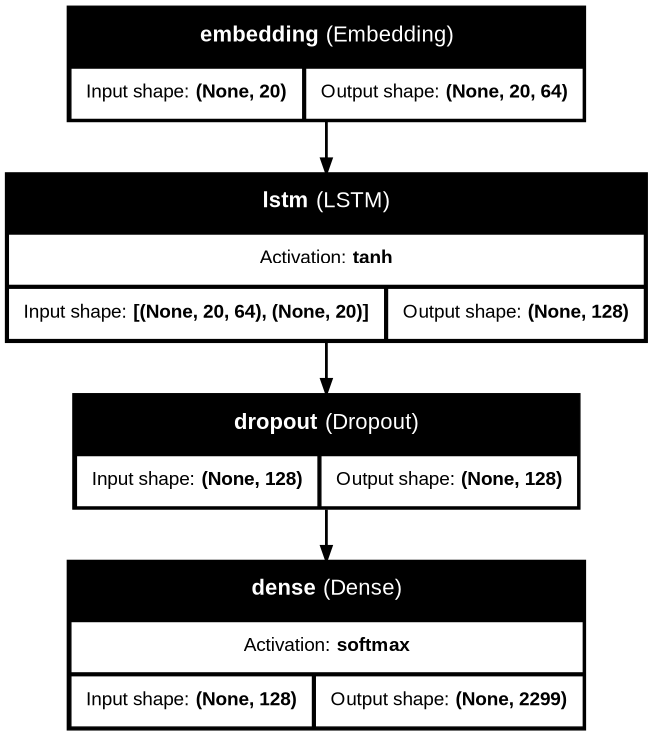
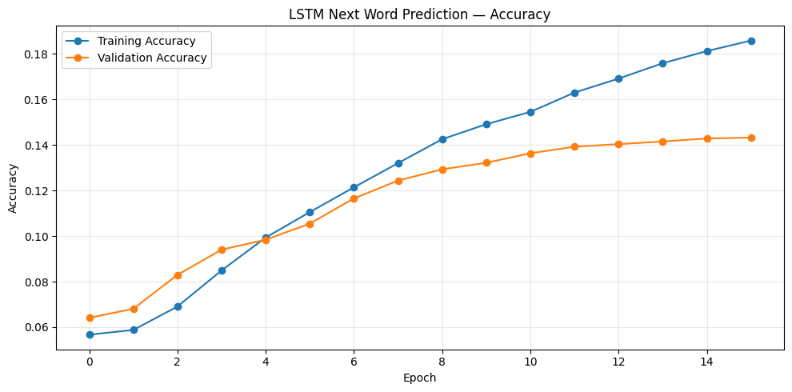
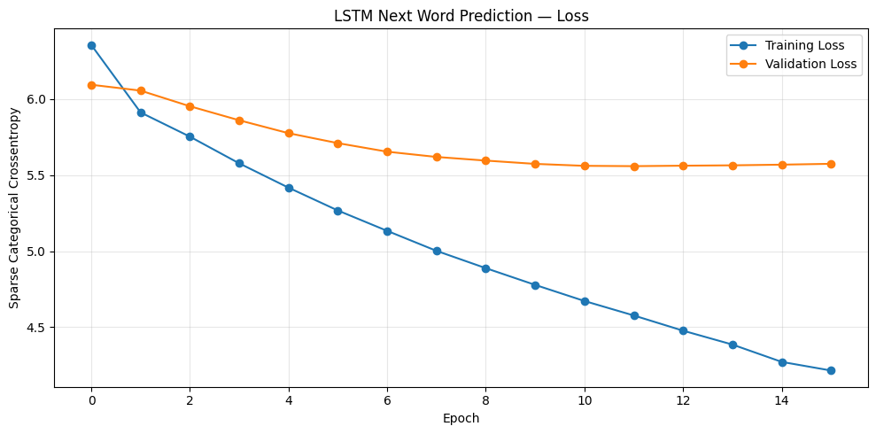
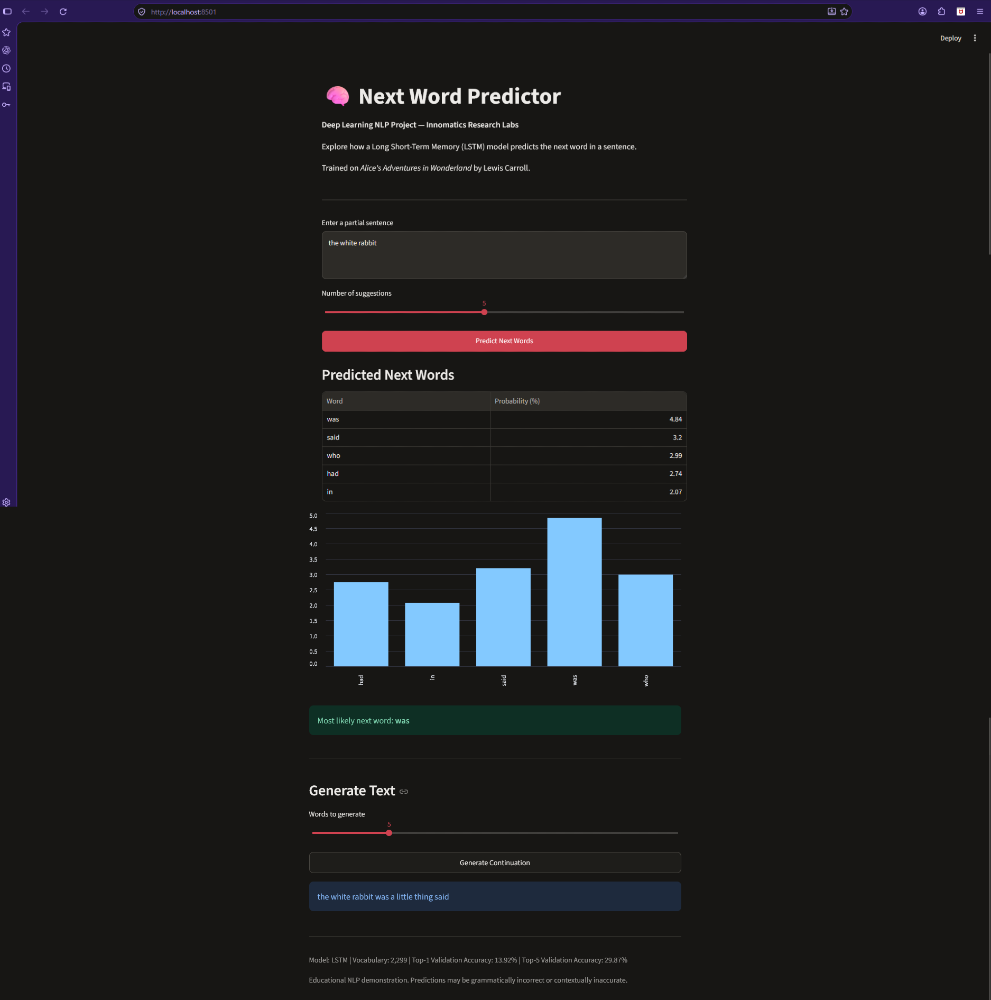
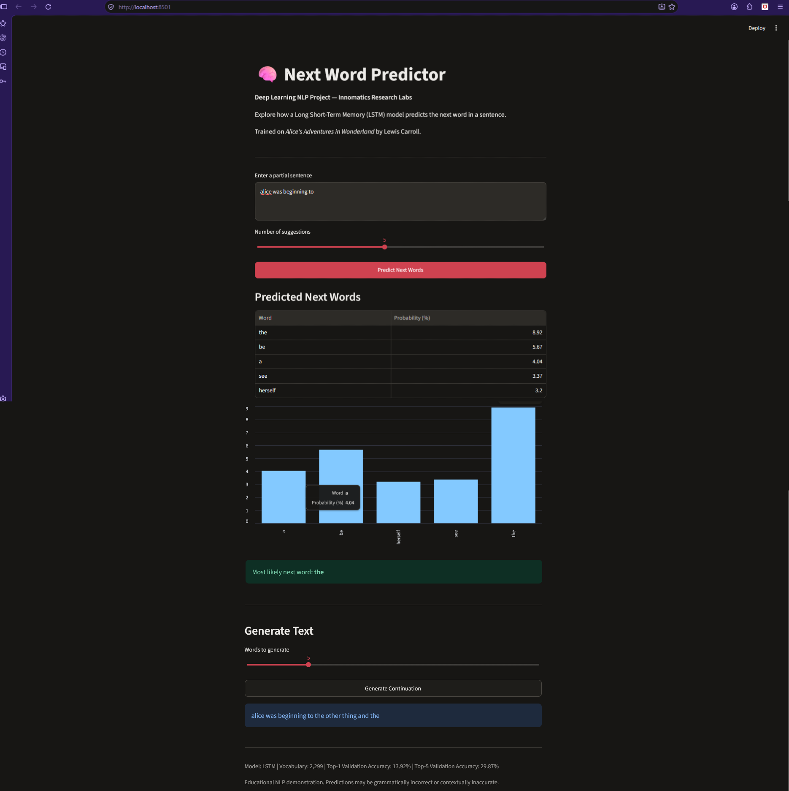

# 🧠 Next Word Prediction Using LSTM

### Deep Learning & Natural Language Processing Project

**Innomatics Research Labs | NLP & Deep Learning**

A deep learning-based **Next Word Prediction System** built using Python, TensorFlow, Keras, and Long Short-Term Memory (LSTM) networks.

The application analyzes a given sequence of text and predicts the most likely next words using a trained language model.

This project demonstrates NLP preprocessing, tokenization, sequence generation, word embeddings, recurrent neural networks, model evaluation, and interactive text prediction using Streamlit.

---

## 🚀 Live Application

Try the interactive Next Word Prediction LSTM app:

**Streamlit Live Demo:** https://wordpredict-lstm.streamlit.app/

Enter a partial sentence to get Top-5 next-word
predictions with their probabilities.

**Validation Performance:**
- Top-1 Accuracy: 13.92%
- Top-5 Accuracy: 29.87%


## 📌 Project Overview

Next Word Prediction is a Natural Language Processing (NLP) task that predicts the most probable next word based on previously entered text.

It is commonly used in:

- Smartphone keyboard suggestions
- Predictive typing applications
- Writing assistance tools
- Text autocomplete systems
- Chatbots and virtual assistants

This project implements an **LSTM-based next-word prediction model** trained on *Alice's Adventures in Wonderland* by Lewis Carroll.

The model learns statistical and sequential patterns from the text and generates Top-5 next-word suggestions.

## 🎯 Project Objectives

1. Collect and preprocess a real-world text corpus.
2. Convert text into numerical tokens using NLP techniques.
3. Generate supervised input-target word sequences.
4. Build an LSTM neural network using TensorFlow/Keras.
5. Train and evaluate the model using validation data.
6. Measure Top-1 and Top-5 prediction accuracy.
7. Develop an interactive Next Word Prediction application using Streamlit.

## 📚 Dataset

**Dataset:** Alice's Adventures in Wonderland  
**Author:** Lewis Carroll  
**Source:** NLTK Gutenberg Corpus / Project Gutenberg  
**Language:** English

The dataset consists of continuous English narrative text.

### Dataset Statistics

| Parameter | Value |
|---|---:|
| Original characters | 144,395 |
| Original alphabetic word tokens | 27,335 |
| Original unique alphabetic words | 2,569 |
| Cleaned sentences | 1,496 |
| Cleaned word tokens | 27,052 |
| Cleaned unique words | 2,549 |
| Training sentences | 1,196 |
| Validation sentences | 300 |
| Training examples | 20,313 |
| Validation examples | 5,243 |
| Model vocabulary size | 2,299 |
| Context length | 20 words |

The text was cleaned by removing unwanted characters, numbers, punctuation, and chapter metadata.

**Note:** Stopwords were retained to preserve grammatical structure and meaningful word sequences.

## 🛠️ Technologies Used

| Technology | Purpose |
|---|---|
| Python | Programming |
| NLTK | Dataset access and sentence tokenization |
| NumPy | Numerical processing |
| Pandas | Data analysis |
| TensorFlow / Keras | Deep learning |
| LSTM | Sequence modeling |
| Matplotlib | Training visualization |
| Streamlit | Interactive web application |
| GitHub | Source code hosting |

## 🔄 Project Workflow

```text
Text Corpus
    |
    v
Text Cleaning & Preprocessing
    |
    v
Sentence Tokenization
    |
    v
Train / Validation Split
    |
    v
Word Tokenization
    |
    v
Input-Target Sequence Generation
    |
    v
Sequence Padding (20 Tokens)
    |
    v
Embedding Layer
    |
    v
LSTM Layer
    |
    v
Dropout
    |
    v
Dense + Softmax
    |
    v
Next Word Probability Distribution
    |
    v
Top-5 Word Suggestions
```

## 🧹 Data Preprocessing

The following preprocessing steps were performed:

1. Removed book metadata and chapter headings.
2. Converted text to lowercase.
3. Split the corpus into sentences.
4. Removed unnecessary punctuation, special characters, and numbers.
5. Normalized whitespace.
6. Preserved stopwords to maintain grammatical information.
7. Split sentences into training and validation sets.
8. Converted words into integer token IDs.
9. Generated next-word training examples.
10. Applied pre-padding to create fixed-length sequences.

### Example of Sequence Generation

**Original sentence:**

`alice was beginning to get tired`

| Input sequence | Target word |
|---|---|
| alice was | beginning |
| alice was beginning | to |
| alice was beginning to | get |
| alice was beginning to get | tired |

Each sequence teaches the model to predict the next word based on its previous context.

## 🧠 LSTM Model Architecture

The deep learning architecture uses an Embedding layer, an LSTM layer, Dropout, and a Dense Softmax classification layer.

| Layer | Output Shape | Parameters |
|---|---|---:|
| Embedding | (None, 20, 64) | 147,136 |
| LSTM | (None, 128) | 98,816 |
| Dropout | (None, 128) | 0 |
| Dense + Softmax | (None, 2299) | 296,571 |
| **Total** | | **542,523** |

### Model Configuration

| Parameter | Value |
|---|---|
| Vocabulary size | 2,299 |
| Context length | 20 |
| Embedding dimension | 64 |
| LSTM units | 128 |
| Dropout rate | 0.30 |
| Output activation | Softmax |
| Optimizer | Adam |
| Learning rate | 0.001 |
| Loss function | Sparse Categorical Crossentropy |
| Batch size | 64 |
| Maximum epochs | 20 |

### Architecture Diagram



## 📈 Model Training and Evaluation

The LSTM model was trained using 20,313 input-target sequences and validated using 5,243 examples.

EarlyStopping, ModelCheckpoint, and ReduceLROnPlateau callbacks were used to manage training and reduce overfitting.

### Training Results

| Metric | Result |
|---|---:|
| Epochs completed | 16 |
| Best epoch | 12 |
| Final training accuracy | 18.58% |
| Final validation accuracy | 14.32% |
| Restored model validation accuracy | 13.92% |
| Best validation loss | 5.5591 |

The model showed steady improvement during training. Validation loss reached its minimum at epoch 12 and subsequently began to increase slightly, indicating possible overfitting.

EarlyStopping restored the weights from epoch 12.

### Training Accuracy



### Training Loss



### Final Evaluation

| Evaluation Metric | Result |
|---|---:|
| Top-1 Accuracy | **13.92%** |
| Top-5 Accuracy | **29.87%** |
| Validation Loss | **5.5591** |

Top-1 accuracy measures how often the model's most probable word matches the target.

Top-5 accuracy measures how frequently the correct next word appears among the five highest-probability predictions.

## 🔮 Sample Next-Word Predictions

The trained model was tested with several text sequences.

| Input Text | Top Predicted Word | Probability |
|---|---|---:|
| alice was beginning to | the | 8.92% |
| the white rabbit | was | 4.84% |
| said the queen | was | 8.22% |
| she was very | little | 2.09% |
| i don't know | it | 13.27% |

### Example: Top-5 Predictions

**Input:** `alice was beginning to`

| Rank | Predicted Word | Probability |
|---|---|---:|
| 1 | the | 8.92% |
| 2 | be | 5.67% |
| 3 | a | 4.04% |
| 4 | see | 3.37% |
| 5 | herself | 3.20% |

### Generated Text Example

**Input:** `alice was beginning to`

**Generated continuation:**

`alice was beginning to the other thing and the`

This example illustrates a limitation of the model: while it learns common word patterns, repeated next-word predictions do not necessarily produce grammatically correct or coherent sentences.

## 💻 Streamlit Web Application

An interactive Streamlit application was developed to demonstrate next-word prediction.

### Application Features

- Accepts user-provided text.
- Predicts the most probable next words.
- Displays Top-1 to Top-10 suggestions.
- Shows prediction probabilities.
- Visualizes word probabilities using a bar chart.
- Supports automatic text continuation.
- Displays evaluation metrics and model information.

### Application Screenshots

**Next-Word Suggestions**



**Text Generation**



## 📂 Project Structure

```text
Next-Word-Prediction/
│
├── app.py
├── requirements.txt
├── README.md
├── .gitignore
├── next_word_lstm.keras
├── tokenizer.json
├── model_config.json
│
├── notebooks/
│   └── Next_Word_Prediction_LSTM_Project.ipynb
│
└── screenshots/
    ├── next_word_lstm_architecture.png
    ├── next_word_training_accuracy.png
    ├── next_word_training_loss.png
    ├── FirstNextWordPredictionGeneration.png
    └── SecondNextWordPredictionGeneration.png

```

## 🚀 Installation and Local Execution

### 1. Clone the repository

```bash
git clone https://github.com/suryaprabhag/Next-Word-Prediction.git
cd Next-Word-Prediction
```

### 2. Create a virtual environment

For Windows:

```powershell
py -3.12 -m venv .venv
```

### 3. Activate the virtual environment

PowerShell:

```powershell
.\.venv\Scripts\Activate.ps1
```

macOS / Linux:

```bash
source .venv/bin/activate
```

### 4. Install dependencies

```bash
python -m pip install --upgrade pip
python -m pip install -r requirements.txt
```

### 5. Run Streamlit

```bash
python -m streamlit run app.py
```

Open the application at:

`http://localhost:8501`

## ⚠️ Project Limitations

The current model is an educational proof of concept.

- Training uses a relatively small corpus from one English novel.
- The model may suggest grammatically incorrect next words.
- Exact next-word prediction accuracy is limited.
- Vocabulary is restricted to the words learned during training.
- The model may struggle with modern terminology or unfamiliar text.
- Greedy text generation may produce repetitive or incoherent sentences.
- The reported metrics are based on validation data rather than a separate final test dataset.

## 🔭 Future Improvements

Potential enhancements include:

1. Training on larger and more diverse text corpora.
2. Comparing LSTM and GRU architectures.
3. Experimenting with bidirectional contexts where appropriate.
4. Using pretrained embeddings such as GloVe.
5. Improving tokenization with subword techniques.
6. Exploring temperature-based sampling for text generation.
7. Comparing the LSTM with transformer-based language models.
8. Evaluating on a separate, unseen test dataset.

## 🎓 Learning Outcomes

Through this project, I gained hands-on experience with:

- NLP text preprocessing.
- Word tokenization and vocabulary creation.
- Sequence generation for supervised language modeling.
- Padding and embedding layers.
- LSTM-based neural network architecture.
- Multiclass classification using Softmax.
- Deep learning training callbacks.
- Training and validation analysis.
- Top-1 and Top-5 accuracy evaluation.
- Model serialization and interactive deployment using Streamlit.

## 🏁 Conclusion

This project demonstrates the complete workflow of developing a next-word prediction model using LSTM and Natural Language Processing techniques.

The model achieved **13.92% Top-1 accuracy** and **29.87% Top-5 accuracy** on validation examples.

Although prediction quality is limited by the small training corpus, the project successfully demonstrates tokenization, sequence modeling, neural network training, evaluation, and interactive next-word suggestions.

The application serves as a foundation for exploring more advanced language modeling techniques.

---

## 👨‍💻 Author

**SuryaPrabha Rebba**

**GitHub:** [suryaprabhag](https://github.com/suryaprabhag)

**Project:** Next Word Prediction Using LSTM

**Learning Program:** Innomatics Research Labs — Data Science / Deep Learning / NLP

## 🙏 Acknowledgements

Special thanks to **Innomatics Research Labs**, the mentors, and the training team for providing guidance and practical learning opportunities in Data Science, Natural Language Processing, and Deep Learning.
